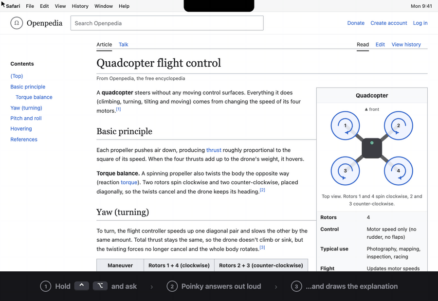

<p align="center"></p>

<h1 align="center">Poinky</h1>

<p align="center"><b>Ask about anything on your screen. It answers out loud and draws the explanation.</b></p>

<p align="center">
  
</p>

<p align="center">
  
  
  <a href="https://github.com/tomyud1/poinky/actions/workflows/ci.yml"></a>
  <a href="LICENSE"></a>
</p>

Poinky lives in your Mac's notch. Hold <kbd>⌃ Control</kbd> <kbd>⌥ Option</kbd>, ask out loud, let go. A little buddy at your cursor points at the answer while a yellow pen sketches it for you, like a friend explaining at your shoulder.

- **Explains by drawing.** Step-by-step sketches in sync with its voice, or a 3D model you can spin.
- **Shows you the way.** "How do I export this?" It circles each click and waits for you.
- **Does it for you.** "Write an email to Sam" or "fill this in". It types, and asks before sending anything.

## Install

One command. It checks your Mac, builds Poinky, installs the natural voice, and puts the app in Applications:

```bash
curl -fsSL https://raw.githubusercontent.com/tomyud1/poinky/main/install.sh | bash
```

Poinky is free and open source. It isn't notarized by Apple (that needs a paid developer account), so there's no download to double-click: the installer builds it on your Mac in a few minutes, which is also why macOS doesn't show a "downloaded from the internet" warning. The voice is a ~350 MB download. It asks before installing Claude Code. To skip the natural voice (Poinky then speaks with Apple's voice), end the command with `bash -s -- --no-voice`. Run the same command again to update.

### What you need

| Requirement | Details |
|---|---|
| **A Mac with macOS 26 or later** | Built and tested on Apple Silicon. Intel Macs on macOS 26 should work but are untested. A notch is optional (without one, Poinky lives in the menu bar). |
| **Claude, one of:** | **Claude Code**, signed in, with a Claude Pro or Max plan ([get it](https://claude.com/claude-code)), **or** an **Anthropic API key** (pay per use; add it in Settings → Claude). Claude Code is needed for background agents ("go fix this in my project"). Everything else works with just an API key. |
| **Internet** | Poinky talks to Claude. Your voice is turned into text on your Mac. |
| **Apple's Command Line Tools** | Free, no Xcode needed. They bring Swift, git and python3, which build Poinky. The installer opens Apple's installer for you if they're missing (version 26 or newer). |
| **macOS permissions** | Microphone and Speech Recognition (click Allow), Screen Recording (switch on by hand, see below), Accessibility (only if you ask Poinky to click or type for you). |
| **About 1 GB of disk** | ~0.5 GB for the natural voice, ~0.2 GB for the build, the rest for the source and the app. The Command Line Tools themselves are separate (~1 GB) if you don't have them. |

The installer sets up everything else for you, in `~/Library/Application Support/Poinky`: the **natural voice** ([Kokoro](https://github.com/thewh1teagle/kokoro-onnx), runs on your Mac, English) with its own private Python (installed through [uv](https://docs.astral.sh/uv/)), plus Poinky's settings and memory. Nothing is installed system-wide, and uninstalling removes it all. It also offers to install Claude Code if you don't have it.

### First run

1. Open Terminal, run `claude` once and sign in (skip if you use an API key).
2. Hold <kbd>⌃ Control</kbd> <kbd>⌥ Option</kbd>, ask something, let go. macOS asks for **Microphone** and **Speech Recognition**: click Allow.
3. **Screen Recording** has to be switched on by hand: System Settings → Privacy & Security → Screen & System Audio Recording → turn Poinky on, then reopen Poinky.

### Troubleshooting

- **"Claude Code isn't installed" or a login error:** run `claude` in Terminal and sign in, or use an API key (✨ menu → Settings → Claude).
- **It doesn't see my screen:** Screen Recording is off. Turn it on, then quit and reopen Poinky.
- **macOS asks for permissions again after an update:** the installer makes a local signing certificate ("Poinky Local Signing") so it shouldn't. If you clicked "Don't allow" when macOS asked to let `codesign` use it, run the installer again and choose Always Allow.
- **No natural voice:** run the install command again (it only adds what's missing), or pick Apple voices in Settings → Voice.
- **The build failed:** the installer prints the end of its log. The whole log is in `~/Library/Application Support/Poinky/install.log`; please attach it to an [issue](https://github.com/tomyud1/poinky/issues).

### Uninstall

```bash
curl -fsSL https://raw.githubusercontent.com/tomyud1/poinky/main/install.sh | bash -s -- --uninstall
```

It removes the app and the source, and asks before deleting your settings, memory and the voice (add `--purge` to skip the question). macOS keeps the permissions list itself: remove Poinky there if you want it gone from System Settings.

## Use it

| Do this | To |
|---|---|
| Hold <kbd>⌃</kbd><kbd>⌥</kbd> and talk | Ask about your screen |
| Hold <kbd>⌃</kbd><kbd>⌥</kbd> and drag with the mouse | Circle what you mean |
| Tap <kbd>⌃</kbd><kbd>⌥</kbd> | Stop it |
| <kbd>⌃</kbd><kbd>⌥</kbd><kbd>Space</kbd> | Hands-free conversation |

**Private by design:** your voice is turned into text on your Mac, and screenshots go only to Claude, only when you ask. No accounts, no tracking. [More on privacy and safety →](docs/GUIDE.md#privacy)

## Where it's going

Claude Code agents that live on your screen instead of in a window. Ask Poinky for something big and a small colored helper buds off your cursor, flies to the side of the screen, and works there with live progress notes. When it's done, it flies back and Poinky tells you what it did. [Read the vision and plan →](docs/VISION.md)

## Learn more

[User guide](docs/GUIDE.md) · [Vision](docs/VISION.md) · [How it works](CLAUDE.md) · [Changelog](CHANGELOG.md) · [Contributing](CONTRIBUTING.md) · [Security](SECURITY.md) · [Third-party notices](THIRD_PARTY_NOTICES.md)

Inspired by [Clicky](https://github.com/farzaa/clicky). MIT © 2026 Tomer Yudovic.
