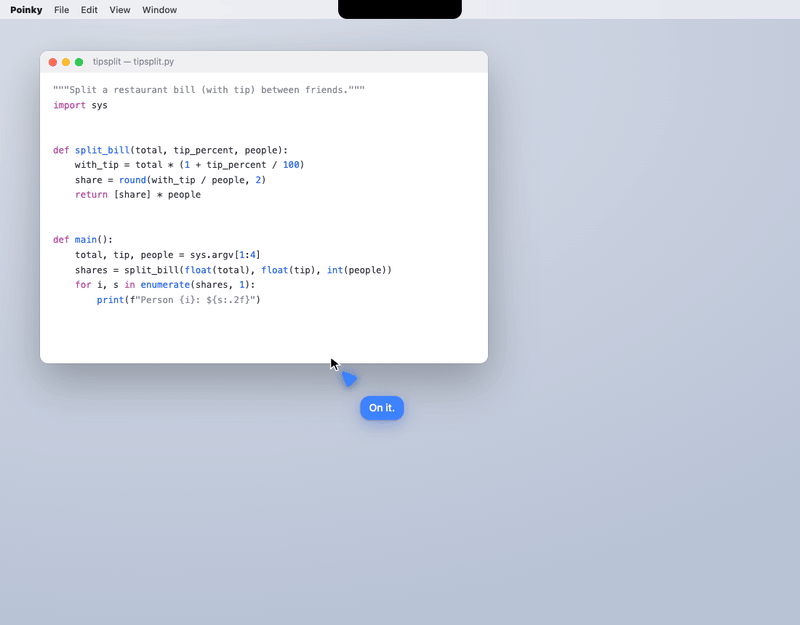

# Where Poinky is going

## The idea

Powerful agents like Claude Code live in their own app and window. You switch to them, type, wait, and switch back. Poinky moves them onto your screen, where you already are.

Hold the keys and talk. The **main agent** (the buddy at your cursor) sees your screen, hears you, and answers right away. While it talks it can sketch in 2D or 3D, click and type for you, or **hand work to helpers**.

A helper is a smaller colored cursor that buds off the main cursor. The main cursor turns to it and hands it the task. The helper nods, flies to the side of your screen, and works there. As it works, it writes short progress notes the way the main agent captions its speech. When it's done, it celebrates with a small animation and a satisfying sound, flies back to the main cursor, and the main agent tells you what it did.

Poinky should become the main way people use Claude Code, so it has to be at least as capable as the terminal. Every helper is a real Claude Code session, with your CLAUDE.md, skills and MCP servers. Most people don't read the diffs an agent makes. They want to see what it's doing and hear what it did, so progress and summaries come first. Full logs are always one click away.

## Design bar

It should look, move, and sound like something Apple made. HeyClicky's visuals and sounds set the mood. These rules apply to every feature below:

- **Motion is physical.** Everything moves on springs, nothing moves linearly, and nothing teleports. One set of timings is shared across the app, so the main cursor and the helpers feel like one family. A helper keeps a little momentum when it lands, and turns to face where it's going.
- **Calm by default.** Helpers stay small and quiet at the edge of the screen, and only the newest progress line shows. They never cover what you're working on: they slide away from your cursor and from the window you're using.
- **Sounds that belong together.** Short and soft, all tuned to one key so that overlapping sounds harmonize instead of clashing. A sound is panned left or right to where its helper is on screen, and it ducks under Poinky's voice. Spawning, finishing, needing you and failing each have their own sound, and a sound is only heard when something actually happens. Volume and mute are in settings, and the app respects Focus.
- **Colors that work for everyone.** Each helper has a color and a name ("Mint", "Coral", "Violet"; never blue, which is the main buddy's color), so you and the main agent can refer to it. Color is never the only cue: each helper also has a letter or shape, for color-blind users.
- **Accessible.** Reduced Motion swaps flights for fades. VoiceOver announces spawns, hand-raises, and finished tasks. It looks right in light and dark mode.
- **Fast.** The main agent never does long work itself. It answers in a second or two and hands anything longer to a helper. Four working helpers should stay at 120 fps, with no fans spinning up.

## How it works

The pieces already in the app:

| Piece | Today | What changes |
|---|---|---|
| Main agent | The talker and teacher, `CallController` | Hands tasks to helpers through `<agent>` (it already can), and announces it |
| Helpers | `AgentManager` runs `claude -p` invisibly; reports are spoken when idle | They get a body on screen, a live event stream, input you can talk into, and permission requests |
| Cursors | `web/buddy.js` draws one buddy | Draws the main buddy plus a helper layer: spawn, flight, dock, report back |
| Sounds | `Earcons`: a few tones generated in code | One designed sound set, panned to where each helper is |
| Overlay | One click-through panel (`Overlay.swift`) | Clickable where a helper is (as cards already are) |

## Plan

Each phase ends with something you can use and a test that proves it works. The rule: no phase starts until the last one passes its tests in the real app.

### Phase 0: Helpers you can see into (plumbing): done
Turn each background agent into a live session the app can watch and talk to.
- Keep each helper's input open (`--input-format stream-json`, like the talker), so you can send it messages while it runs.
- Turn the raw output into a few plain events: *started*, *step* ("Reading Overlay.swift", "Running tests"), *checklist* (from its to-do list), *needs you*, *done*, *failed*. Build progress text from these events locally, without extra model calls.
- Add a **fake helper**: a script that plays recorded event streams with real timing. It lets us test every animation and sound without spending tokens.
- **Tests:** a `swiftc` harness feeds recorded streams (success, failure, permission request, crash) through the parser and checks the events. A real `claude -p` run on `demo/sample-project` produces the same kinds of events.
- **Learned:** a follow-up sent while a helper works is folded into its current turn, and one sent just after it finished starts a new turn, so a helper counts as done 3 s after its last answer. Helpers often get refused for simple things, like running the program they just fixed, which makes Phase 6 (raise a hand) important.
- **Run the tests:** `tools/test-helpers.sh` (add `--live` for a real Claude Code helper).

### Phase 1: The Agent Lab (design first): done
A web page, `web/agents-lab.html`, that plays the whole choreography with fake helpers: spawn, hand-off, flight, dock, working, done, report back, raise hand, failure. It has a timeline scrubber, a speed control, a sound toggle, and light and dark backgrounds. This is where the motion and sounds get tuned, together, before anything goes into the app.
- **Tests:** play it in the browser pane, record GIFs of each moment, and review them together. Check the frame time with four helpers, Reduced Motion, and dark mode. Nothing moves on to Phase 2 until you're happy with the look and sound.
- **Open it:** `open web/agents-lab.html`. Change any slider, then "Copy settings" and paste the result to Claude to make it the default. "Save sounds" writes every sound as a `.wav` file.

  

### Phase 2: Spawn and hand-off: done
When the main agent starts a helper, the main cursor pauses and a small cursor buds off it. The main cursor turns to it, and a short line shows the hand-off ("Mint, fix the failing login test"). The helper nods and arcs to the edge of the screen. Several helpers spawned at once fan out one after another. The main agent says one short line ("I'll have Mint fix that") and goes back to you.
- **Tests:** in the real app, with fake helpers, spawn 1 and 3 helpers, on one screen and on two screens, and in a full-screen app. Then spawn a real helper on `demo/sample-project`. Measure the main agent's time to first word before and after, to confirm it isn't slower.
- **Built:** helpers appear in the real overlay with the lab's motion and sounds, show their real progress, and fly back when done. The main buddy squashes as one buds, faces it during the hand-off and hops when it merges back. The overlay stays up while helpers work after a session ends. The talker names the helper out loud ("I'll have Mint look into that"). `tools/test-helpers.sh --screen` checks it through the real overlay.
- **Learned:** with no session running, macOS "naps" Poinky and its animations freeze, so the overlay now keeps Poinky awake while anything is on screen. Still to check by hand: two screens and full-screen apps (Phase 3 handles where helpers sit).

### Phase 3: Working at the edge: done
Helpers line up at the side of the screen, away from the window you're using and from your cursor. Each shows its color, its name, the latest progress line, and a progress ring from its checklist, with a small "working" motion and a tick for each finished item. Tasks waiting for a free slot show as small dots below the line. Hovering a helper opens a card: the task, its steps so far, the time elapsed, and Stop, Open log, and Open folder buttons.
- **Tests:** 4 helpers working for 10 minutes: frame rate, CPU and memory. The line of helpers moves when you drag a window over it. Hover and click work while the rest of the overlay stays click-through. Stop really ends the process.
- **Built:** helpers never sit on top of each other: hand-offs happen one at a time, finished helpers line up to report (on the other side of the main buddy from where new ones bud), and only one asks a question at a time while the others wait with a pulsing ring. In Auto, they work at the edge with more room beside the window you're using and fly across when that changes. Passing over a card fades it; resting on a helper opens its card (task, folder, to-do list or recent steps, time, and Stop, Log, Folder; Stop asks once more). The open card is the only part of the overlay that takes clicks.
- **Learned:** WebKit redraws an animated SVG in software every frame. Four helpers cost 27% of a core until their working motions moved to their own layers (now about 14%, against a 10% floor with no motion at all). The glass blur on the cards was dropped: the overlay can't see the desktop behind it, so it only cost time. When nothing moves, the page redraws 10 times a second instead of 60 to 120.

### Phase 4: Done and report back: done
Finishing plays a small celebration (a burst and a check mark) with the "done" sound, and a gentler version for a failure. The helper flies back to the main cursor and the main agent speaks its summary. Then the helper merges back in. If you're talking or busy, the helper waits at the edge with a badge and reports when you're free, as reports work today. Every report is also kept in the notch's history.
- **Tests:** finish while you're mid-question: it waits. Then a failure, a stop, and two helpers finishing at the same moment: the reports queue in order and the sounds don't pile up.
- **Built:** a finished helper celebrates (or droops) at the edge, then waits there with a badge (a check, or a gray "!") and its card shows the first sentence of what it did; resting on it shows the whole summary. Poinky waits until you're free: not while you hold the keys, while it's talking, while you're typing (a 2-second pause) or while the screen is locked. Then the helpers it's about to talk about fly to the buddy, stay beside it while it speaks, and merge one at a time when it's done (or when you cut in). Two finishing together celebrate about half a second apart, so their sounds don't stack. The notch shows a colored dot for each helper waiting to tell you, and its hover panel lists the last three reports (click one for its log).
- **Learned:** the report and the speech have to be driven from the app, not from a timer in the page: the talker takes one to three seconds to start, and a report that ends on a timer either cuts the buddy off or leaves it talking alone. With the screen locked WebKit stops animating, so nothing should happen on screen (or out loud) until you're back.

### Phase 5: Talk to a helper: done
Hold the keys while pointing at a helper to talk to that helper: "also add a test", "what are you doing?", "stop". Follow-ups go into its session. Status questions are answered from its events, without waking a model. The main agent always knows what every helper is doing, so you can also say "how's Mint doing?"
- **Tests:** a follow-up in the middle of a run changes what the helper does. Stop by voice. A status answer uses no extra model call.
- **Built:** the page reports which helper the mouse is on (the helper itself or its card). Holding the keys there makes it grow a little and open its card, whose line says "Listening…". When you let go, Poinky works out what you meant without a model: "stop" stops it; "what are you doing?" gets a spoken answer built from what it reported ("Mint is running the tests. It has done 2 of 3 steps, 3 minutes in."); anything else goes into its session as a follow-up, and its card says "✓ Got it" with a soft sound. A helper still waiting for a free spot gets the follow-up added to its task. By name works too: "how's Mint doing?", "stop Coral", "tell Mint to also add a test", "Mint, also update the README". Anything phrased differently reaches the main agent, which can use `<tell agent>` and `<stop agent>`. Asking a finished helper for more hands it to the main agent with that helper's summary. Also new: every part of Poinky (talker, teacher, guide, doer, helpers) has its own model and effort in Settings → Claude.
- **Learned:** speech bubbles next to a helper at the edge end up under its open card (or off the screen), so a helper "speaks" through its card line there. Matching names needs care: "Is mint tea good for you?" and "What color is coral?" must not reach a helper, so names only count in a few clear sentence shapes. Claude Code's short model names follow its version: 2.1.119 still maps "haiku" to Haiku 4.5 and refuses Opus 5.5, so Settings lists full model names and offers to update Claude Code.

### Phase 6: Raise a hand
Helpers can't ask you anything today: whatever isn't pre-approved is refused. Instead, route Claude Code's permission prompts and questions to Poinky (`--permission-prompt-tool`, served by Poinky; check the exact mechanism first). The helper flies to you, says what it wants in plain words ("Can I run npm install?"), and waits for a spoken yes or no. Nothing is ever approved automatically. Risky actions (pushing, deleting, installing, sending) always need a yes.
- **Tests:** a task that needs `npm install`: say yes, then say no. Ignore the request: the helper keeps waiting without blocking the main agent. Make sure no approval can come from screen content.

### Phase 7: As powerful as the terminal
- The main agent splits big tasks between several helpers. Helpers that work in the same repo get their own git worktree, so their changes don't collide.
- Resume a helper later ("continue the login fix") through Claude Code's resume.
- Only one agent can use the real mouse and keyboard at a time. A helper that needs the screen "borrows the hands" and you can see it, while every other helper works out of sight.
- **Tests:** two helpers in one repo finish without conflicts. Resume one after restarting Poinky. Two helpers that both need the screen take turns.

### Phase 8: Polish and launch
A full pass on sound and motion, settings (sounds, volume, Reduced Motion, helper limit), VoiceOver, a performance budget, and a new demo GIF. Then release and announce "Poinky agents".
- **Tests:** a clean install on a second Mac, a full scripted demo run, and the earlier phases' tests again.

## Decisions
- **Hotkey:** the existing ones stay: hold ⌃⌥ to talk, ⌃⌥Space for hands-free, tap ⌃⌥ to stop. Pointing at a helper while holding ⌃⌥ talks to that helper.
- **Sounds:** they become audio files, one small set shared by the app (`Resources/sounds/`), instead of tones generated in code as `Earcons` does today. Files sound richer (layers, texture, a real room) and can be swapped without code changes. First pass: we design them ourselves with layered synthesis, rendered to files and tuned in the Agent Lab. Later, if possible: a sound designer polishes the final set. Any third-party sound must have a license that allows it (CC0 or bought).
- **Helpers at once:** up to 3 working at a time by default (a setting, 1 to 6). More tasks wait in line as a small queued helper and start when one finishes, and Poinky says so. It doesn't ask before each one. The reasons for a limit: Claude plan usage limits (several helpers use them up fast), room at the edge of the screen, and how much a person can follow.
